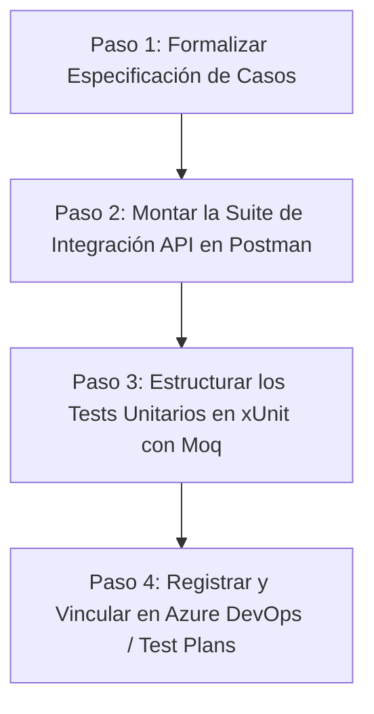

# PLANTEAMIENTO OPERATIVO DE PRUEBAS DE SOFTWARE (PUNTOS 4 Y 5)

## Planificación Detallada: Aceptación, Integración (API) y Unitarias

**Documento Relacionado:** [[INVESTIGACION_TIPOS_DE_PRUEBAS]] | [[REQUISITOS_NORMATIVOS_PRUEBAS]]
**Proyecto Base:** `SeguridadWeb` (Roles, Usuarios y Autenticación) / Plataforma de Gestión
**Estándares Rectores:** ISO/IEC/IEEE 29119 (Partes 1-4), ISO 9001:2015 (§8.3.4 y §8.6), IEEE 1008, RFC 9110

---

## 1. VISIÓN GENERAL Y ARQUITECTURA DE PRUEBAS

Para responder con exactitud a los requerimientos de la planificación académica y profesional, los tres niveles solicitados se estructuran de acuerdo con la **Pirámide de Pruebas**:

| Nivel Solicitado                | Punto en Planificación   | Tipo de Prueba               | Enfoque                 | Propósito Central                                                                                                       |
| ------------------------------- | ------------------------- | ---------------------------- | ----------------------- | ------------------------------------------------------------------------------------------------------------------------ |
| **Nivel 3: Aceptación**  | **Punto 4**         | Pruebas de Aceptación (UAT) | Caja Negra (Black-Box)  | Validar que el sistema cumpla con los requisitos del negocio y el usuario final (¿Se construyó el producto correcto?). |
| **Nivel 2: Integración** | **Primer Punto 5**  | Pruebas de API / Contratos   | Caja Gris (Gray-Box)    | Verificar la comunicación, contratos JSON, protocolos HTTP y persistencia real entre capas y servicios.                 |
| **Nivel 1: Unitarias**    | **Segundo Punto 5** | Pruebas Unitarias de Código | Caja Blanca (White-Box) | Verificar en aislamiento absoluto la lógica de métodos y clases individuales mediante patrón AAA y Mocks.             |

---

## 2. PLANTEAMIENTO DETALLADO POR NIVEL DE PRUEBA

---

### A. PRUEBAS DE ACEPTACIÓN (PUNTO 4)

> **Requerimiento:** *"Desarrollar la planificación de las pruebas de aceptación"*

#### 1. ¿Qué se tiene que cumplir? (Criterios y Normas)

* **Norma Aplicable:** ISO 9001:2015 Cláusulas 8.3.4 (d) y 8.6; ISO/IEC/IEEE 29119-2 Cláusula 6.4.
* **Criterios de Entrada (Entry Criteria):**
  * Pruebas unitarias y de integración concluidas y aprobadas al 100%.
  * Cero defectos críticos o bloqueantes abiertos (Severity 1 / 2).
  * Despliegue estabilizado en ambiente Staging / Pruebas con datos representativos.
* **Criterios de Aceptación:** Derivados directamente de las Historias de Usuario aprobadas (HU #45 y #46).
* **Criterios de Salida (Exit Criteria / Sign-off):**
  * 100% de los casos de aceptación ejecutados.
  * Tasa de aprobación mínima del 95% sin incidencias mayores pendientes.
  * Aprobación formal documentada (*Sign-off*) del Product Owner / Usuario Clave.

#### 2. ¿Cómo se tiene que hacer? (Metodología y Técnicas)

* **Técnica:** Especificación basada en escenarios con sintaxis **Gherkin (BDD)**:
  * **DADO:** Contexto inicial y precondiciones del usuario.
  * **CUANDO:** Acción o evento ejecutado por el usuario en la interfaz.
  * **ENTONCES:** Resultado observable de valor para el negocio.
* **Tratamiento de Incidencias:** Cualquier discrepancia genera una captura/evidencia y un ítem de defecto formal (ejemplo: **Bug #137** en Azure DevOps).

#### 3. ¿En dónde se tiene que hacer? (Herramientas y Entorno)

* **Entorno:** Aplicación web desplegada en ambiente pre-productivo (Staging / Browser).
* **Herramientas de Gestión:** **Azure DevOps Test Plans** / **Azure Test Runner** (o Jira con Xray/Zephyr).
* **Artefacto de Registro:** Suites de prueba asociadas a las Historias de Usuario en el Backlog.

#### 4. Matriz de Casos de Prueba de Aceptación

| ID Caso             | Historia de Usuario                        | Escenario Gherkin                                                                                                                                                                                                                                                                                                                     | Resultado Esperado                                                          |
| ------------------- | ------------------------------------------ | ------------------------------------------------------------------------------------------------------------------------------------------------------------------------------------------------------------------------------------------------------------------------------------------------------------------------------------- | --------------------------------------------------------------------------- |
| **CP-ACC-01** | **HU #45:** Registro de Roles        | **Dado:** Usuario Administrador autenticado en la plataforma.**Cuando:** Ingresa a "Gestión de Roles", llena nombre `"Supervisor Operativo"`, selecciona permisos de Lectura/Escritura y presiona "Guardar".**Entonces:** El sistema muestra confirmación exitosa y el rol aparece en la lista activa de roles. | Rol creado visible en catálogo, persistido y listo para asignación.       |
| **CP-ACC-02** | **HU #46:** Asignación de Roles     | **Dado:** Existe el rol `"Supervisor Operativo"` y un usuario activo `"operador1@empresa.com"`.**Cuando:** El Administrador asigna el rol al usuario y guarda los cambios.**Entonces:** Al iniciar sesión con `"operador1"`, el usuario solo tiene acceso a las pantallas autorizadas.                       | Permisos aplicados según rol sin permitir accesos a módulos restringidos. |
| **CP-ACC-03** | **Seguridad / Aceptación Negativa** | **Dado:** Usuario con rol estándar "Operador".**Cuando:** Intenta acceder directamente vía URL al módulo administrativo `/Admin/Roles`.**Entonces:** El sistema bloquea el acceso y redirige a pantalla de error 403 / "Acceso Denegado".                                                                      | Protección de rutas administrativas validada ante el usuario final.        |

---

### B. PRUEBAS DE INTEGRACIÓN / PRUEBAS DE API (PRIMER PUNTO 5)

> **Requerimiento:** *"Desarrollar la planificación de las pruebas de API"*

#### 1. ¿Qué se tiene que cumplir? (Criterios y Normas)

* **Norma Aplicable:** ISO/IEC/IEEE 12207:2017 Cláusula 7.1.5; ISO/IEC 25010 (Interoperabilidad); RFC 9110 (Semántica HTTP); OpenAPI 3.0.
* **Conformidad de Contratos de Interfaz:** Respetar estrictamente los esquemas JSON de entrada y salida (nombres de atributos, tipos de datos, obligatoriedad).
* **Semántica de Códigos de Estado HTTP:**
  * Operaciones exitosas: `200 OK` (lecturas/actualizaciones), `201 Created` (creaciones).
  * Errores de cliente controlados: `400 Bad Request` (payload inválido), `401 Unauthorized` (falta token), `404 Not Found` (recurso no existe).
  * **Criterio Crítico:** Ninguna petición inválida debe producir un error `500 Internal Server Error` no controlado.
* **Integridad Transaccional:** Comprobar que los cambios impacten correctamente la base de datos real.

#### 2. ¿Cómo se tiene que hacer? (Metodología y Técnicas)

* **Técnica:** Caja Gris (Gray-Box Testing). Se evalúan los endpoints en secuencias encadenadas respetando dependencias CRUD:
  $$
  \text{POST /api/rol} \longrightarrow \text{GET /api/rol/\{id\}} \longrightarrow \text{PUT /api/rol/\{id\}} \longrightarrow \text{DELETE /api/rol/\{id\}} \longrightarrow \text{GET (Verificar 404)}
  $$
* **Validación de Límites y Seguridad:** Enviar payloads vacíos, nombres nulos, IDs inexistentes y validar que no se expongan stack traces de la base de datos.

#### 3. ¿En dónde se tiene que hacer? (Herramientas y Entorno)

* **Entorno:** Backend REST desplegado en servidor de pruebas (`https://localhost:7643/` o servidor Staging) con base de datos SQL activa.
* **Herramientas de Ejecución:** **Postman** (Colecciones de Requests y Tests Scripts automáticos), **Newman** (CLI para integración continua), Swagger UI o REST Client.
* **Artefacto de Registro:** `Plantilla Casos de Pruebas de API.xlsx`.

#### 4. Matriz de Casos de Prueba de API (Basada en la Plantilla del Proyecto)

| ID Caso             | Verbo HTTP | Endpoint          | Payload / Parámetros                      | Código Esperado             | Cuerpo Esperado / Aserción                    |
| ------------------- | ---------- | ----------------- | ------------------------------------------ | ---------------------------- | ---------------------------------------------- |
| **CP-API-01** | `POST`   | `/api/rol`      | `{"Nombre": "Rol Test"}`                 | `200 OK` / `201 Created` | `{"Confirmacion": 1, "Id": > 0}`             |
| **CP-API-02** | `GET`    | `/api/rol/{id}` | Parámetro`id` generado en CP01          | `200 OK`                   | Objeto JSON con`{Id, Nombre: "Rol Test"}`    |
| **CP-API-03** | `PUT`    | `/api/rol/{id}` | `{"Id": id, "Nombre": "Rol Modificado"}` | `200 OK`                   | `{"Confirmacion": 1}`                        |
| **CP-API-04** | `DELETE` | `/api/rol/{id}` | Parámetro`id`                           | `200 OK`                   | `{"Confirmacion": 1}`                        |
| **CP-API-05** | `GET`    | `/api/rol/{id}` | Mismo`id` (tras ser eliminado)           | `404 Not Found`            | Objeto de error controlado                     |
| **CP-API-06** | `POST`   | `/api/rol`      | `{"Nombre": ""}` (Inválido / Vacío)    | `400 Bad Request`          | Mensaje:`"El nombre del rol es obligatorio"` |
| **CP-API-07** | `GET`    | `/api/rol`      | Ninguno (Listado general)                  | `200 OK`                   | Arreglo JSON de roles existentes               |

---

### C. PRUEBAS UNITARIAS (SEGUNDO PUNTO 5)

> **Requerimiento:** *"Desarrollar la planificación de las pruebas Unitarias"*

#### 1. ¿Qué se tiene que cumplir? (Criterios y Normas)

* **Norma Aplicable:** ISO/IEC/IEEE 29119-4 Sección 6; IEEE 1008-1987; ISO/IEC/IEEE 12207 Cláusula 7.1.4.
* **Aislamiento Total (Mandatorio):** Prohibido acceder a bases de datos reales, archivos en disco o red. Todas las dependencias (repositorios, APIs externas) deben sustituirse por dobles de prueba (**Mocks**).
* **Métricas de Cobertura de Código:**
  * Cobertura de Sentencias (*Statement Coverage*): $\ge 85\%$.
  * Cobertura de Ramas (*Branch Coverage*): 100% de caminos lógicos en validaciones (`if/else`).
* **Determinismo:** El resultado de la prueba debe ser repetible y ejecutarse en milisegundos.

#### 2. ¿Cómo se tiene que hacer? (Metodología y Técnicas)

* **Patrón de Diseño AAA:**
  * **Arrange (Disponer):** Configurar mocks, inicializar variables y definir el comportamiento esperado del mock (`mockRepo.Setup(...)`).
  * **Act (Actuar):** Invocar el método específico de la clase bajo prueba (`var resultado = await servicio.CrearAsync(rol);`).
  * **Assert (Verificar):** Validar con aserciones automáticas (`Assert.True(resultado > 0);`, `Assert.Throws<ArgumentException>(...);`).
* **Casos Positivos y Negativos de Frontera:** Evaluar comportamiento ante datos correctos, datos nulos y cadenas vacías.

#### 3. ¿En dónde se tiene que hacer? (Herramientas y Entorno)

* **Entorno:** Proyecto de pruebas dentro de la solución de software (ej. `SeguridadWeb.UnitTests`).
* **Frameworks y Librerías:** **xUnit** / **NUnit**, **Moq** / **NSubstitute**, FluentAssertions, Coverlet (cobertura).
* **Ejecutor:** IDE (Visual Studio / VS Code) o línea de comandos (`dotnet test`).
* **Trazabilidad:** Casos mapeados a Azure DevOps Test Plans (ej. Test Case ID 134 `UT: Crear un Rol`).

#### 4. Matriz de Casos de Prueba Unitarios

| ID Caso                     | Clase / Método Bajo Prueba      | Condición de Prueba                        | Patrón AAA (Resumen de Lógica)                                                                                                                                                 | Resultado Esperado                                 |
| --------------------------- | -------------------------------- | ------------------------------------------- | -------------------------------------------------------------------------------------------------------------------------------------------------------------------------------- | -------------------------------------------------- |
| **CP-UT-01 (ID 134)** | `RolService.CrearAsync`        | Creación exitosa de rol con datos válidos | **Arrange:** Mock retorna ID generado = 5.**Act:** Invocar `CrearAsync(new Rol { Nombre = "Rol Test" })`.**Assert:** Comprobar que ID retornado sea $> 0$. | Retorna entero positivo (`> 0`)                  |
| **CP-UT-02**          | `RolService.CrearAsync`        | Validación de campo obligatorio vacío     | **Arrange:** Rol con `Nombre = ""`.**Act & Assert:** Invocar `CrearAsync(rol)`.                                                                                  | Lanza`ArgumentException` con mensaje específico |
| **CP-UT-03**          | `RolService.EliminarAsync`     | Eliminación de rol existente               | **Arrange:** Mock simula eliminación exitosa.**Act:** Invocar `EliminarAsync(id: 5)`.**Assert:** Validar que retorne confirmación positiva.                | Retorna`true` o filas afectadas $> 0$          |
| **CP-UT-04**          | `RolService.ObtenerPorIdAsync` | Búsqueda de rol inexistente                | **Arrange:** Mock retorna `null` para ID = 999.**Act:** Invocar `ObtenerPorIdAsync(999)`.**Assert:** `Assert.Null(resultado)`.                           | Retorna`null` sin lanzar excepción de sistema   |

---

## 3. COMPARATIVA TÉCNICA DE LOS TRES NIVELES

```
┌────────────────────┬─────────────────────────────┬─────────────────────────────┬─────────────────────────────┐
│ Parámetro          │ Pruebas Unitarias           │ Pruebas de Integración (API)│ Pruebas de Aceptación       │
├────────────────────┼─────────────────────────────┼─────────────────────────────┼─────────────────────────────┤
│ Ubicación / Dónde  │ Proyecto xUnit en Código    │ Postman / Servidor REST     │ Navegador / Azure Test Plan │
│ Dependencias       │ 100% Mockeadas (Aisladas)   │ Integradas (API + SQL Real) │ Sistema Completo (Staging)  │
│ Velocidad          │ Milisegundos por test       │ Segundos por colección      │ Minutos por flujo de usuario│
│ Quién lo ejecuta   │ Desarrollador / CI Runner   │ Desarrollador / QA Tester   │ QA / Product Owner / Cliente│
│ Foco de Evaluación │ Algoritmo y validación      │ Contratos y comunicación    │ Valor y flujo de negocio    │
└────────────────────┴─────────────────────────────┴─────────────────────────────┴─────────────────────────────┘
```

---

## 4. PLAN DE ACCIÓN: ¿QUÉ TENEMOS QUE HACER? (HOJA DE RUTA)

Para presentar y documentar este planteamiento de forma impecable, debemos seguir estos 4 pasos operativos:



1. **Paso 1: Documentación en Plantillas ISO 29119-3 / Excel**

   * Trasladar las matrices detalladas a las plantillas formales (`Plantilla Casos de Pruebas de API.xlsx` y Plantilla de Pruebas Unitarias).
   * Redactar los escenarios de Aceptación vinculados a las Historias de Usuario #45 y #46.
2. **Paso 2: Ejecución y Evidencias de Pruebas de API (Postman)**

   * Configurar colección Postman con variables de entorno (`{{baseUrl}} = https://localhost:7643`).
   * Añadir aserciones automáticas en JavaScript en la pestaña *Tests* (`pm.response.to.have.status(200);`).
   * Exportar el reporte de ejecución con evidencias de respuesta.
3. **Paso 3: Implementación de Pruebas Unitarias (xUnit)**

   * En el código fuente, verificar la existencia del proyecto de test.
   * Implementar los métodos de prueba con el patrón AAA usando `Moq` para aislar el repositorio.
   * Ejecutar `dotnet test` y capturar el reporte de cobertura.
4. **Paso 4: Carga y Trazabilidad en Azure DevOps**

   * En **Azure Test Plans**, crear el Test Plan del Sprint con 3 Test Suites:
     1. Suite *Pruebas de Aceptación* (Casos Gherkin vinculados a HU).
     2. Suite *Pruebas de API* (Casos REST vinculados a servicios).
     3. Suite *Pruebas Unitarias* (Casos ID 134, etc.).
   * Ejecutar mediante **Azure Test Runner** para registrar estados (`Passed`/`Failed`) y ligar evidencias. En caso de fallo, registrar el **Bug** correspondiente con pasos reproducibles.
