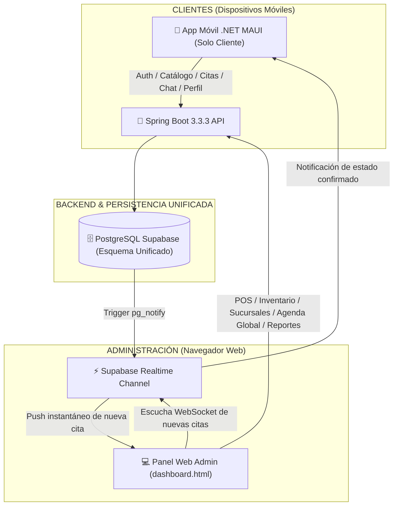

# 📋 PLAN MAESTRO DE INTEGRACIÓN: SHUSHINE STUDIO (APP CLIENTE) + PANEL WEB ADMINISTRATIVO

> **Elaborado mediante:** Antigravity AI + OpenCode Engine (Modelos: *Nemotron 3 Ultra 550B*, *Kimi K3 Architect*, *Gemma 4 31B IT Backend*)  
> **Fecha:** Octubre 2026  
> **Estado:** Aprobado para Planificación e Implementación Técnica  

---

## 1. DIAGNÓSTICO Y ANÁLISIS DE REPOSITORIOS

### A. Repositorio Shushine Studio (`https://github.com/ald297/Shushine_Studio.git`)
* **Propósito:** Plataforma integral de gestión y reservas para salones de belleza y spas, creada para ESFE AGAPE (Alex Fernando Alfaro Diaz & Camila Antonia Calderon Cortez).
* **Arquitectura Móvil (`src/mobile`):**
  * **Framework:** `.NET MAUI` (C# 12 / .NET 8 / XAML).
  * **Patrón de Diseño:** Clean Architecture con MVVM (`CommunityToolkit.Mvvm`).
  * **Capas:**
    * `Core`: Constantes, manejadores de red y modelos de configuración.
    * `Domain`: Entidades (`Cita`, `Cliente`, `Estilista`, `Servicio`, `Reseña`, `Chat`), Repositorios (`IAuthRepository`, `IReservaRepository`, etc.) y Casos de Uso (`CreateAppointmentUseCase`, `GetDisponibilidadUseCase`).
    * `Data`: DTOs, Repositorios implementados y `TokenStorageService`.
    * `Presentation`: Vistas y ViewModels organizados por flujos (`Auth`, `Home`, `Catalog`, `Booking`, `Appointments`, `Profile`, `Reviews`, `Chat`, `Notifications`).
  * **Detección Clave:** Contiene una carpeta interna `Presentation/Views/Admin` que implementaba vistas administrativas básicas en el móvil.
* **Arquitectura Backend (`src/backend`):**
  * **Framework:** Java Spring Boot 3.3.3 RESTful API.
  * **Seguridad:** Spring Security 6 con filtros JWT de Supabase Auth.
  * **ORM & Persistencia:** Spring Data JPA / Hibernate con pool HikariCP.
  * **Mapeo:** ModelMapper para transformación Entidad ↔ DTO (JSON `camelCase`).
  * **Controladores:** 15 controladores REST (`CitaController`, `ClienteController`, `EstilistaController`, `ServicioController`, `ChatController`, `DashboardController`, etc.).
* **Base de Datos (`docs/DIAGRAMA_BASE_DE_DATOS.md` & `migration_23_tables_shunshine.sql`):**
  * PostgreSQL 15+ en Supabase (23 tablas relacionales + 6 Buckets de Storage).
  * Núcleo transaccional centrado en `citas`, `cita_servicios`, `solicitudes_diseno`, `cotizaciones` y `transacciones_puntos`.

---

### B. Panel Administrativo Web Creado (`salon-de-belleza`)
* **Propósito:** Panel de control centralizado para administración de salones de belleza con gestión multi-sucursal, inventario crítico y punto de venta (POS).
* **Stack Web (`dashboard.html`):**
  * HTML5 semántico + Tailwind CSS (Concepto *Elegancia Serena* `#1A1A2E` / `#D4A574`) + Alpine.js.
  * Visualización de métricas sparkline con Canvas nativo.
  * Selector multi-sucursal en tiempo real (*Polanco, Condesa, Santa Fe, Roma Norte*).
  * 4 KPIs ejecutivos, lista de citas 24h, semáforo de inventario y expediente 360° del cliente.
* **Esquema Relacional (`schema.sql`):**
  * PostgreSQL con RLS avanzado.
  * Tablas especializadas para multi-sucursal (`branches`), stock por sucursal (`branch_stock`), movimientos de inventario (`stock_movements`) y transacciones POS (`sales`, `sale_items`).

---

## 2. DECISIÓN ARQUITECTÓNICA DE DESACOPLAMIENTO (VALIDADA POR OPENCODE)

El orquestador y los arquitectos de OpenCode determinaron la siguiente división estricta de responsabilidades:



### Reglas de Desacoplamiento:
1. **La App Móvil es 100% de uso exclusivo para Clientes:**
   * Se **depreca y elimina** la carpeta `src/mobile/Presentation/Views/Admin` y sus ViewModels asociados.
   * El usuario que inicia sesión en el móvil recibe únicamente la interfaz de cliente (`Role: CLIENTE`).
   * Si un administrador intenta iniciar sesión en la app móvil, el sistema muestra un mensaje indicando: *"Cuenta administrativa detectada. Por favor acceda desde el Panel Web de Administración"*.
2. **El Panel Web es 100% para Operaciones y Administración:**
   * Control exclusivo de apertura/cierre de sucursales, horarios del personal, creación de estilistas, asignación de comisiones, inventario y facturación POS.
3. **Punto de Sincronización Único:**
   * Ambas aplicaciones leen y escriben en la misma base de datos relacional de Supabase a través del backend Spring Boot.

---

## 3. MATRIZ DE MÓDULOS: MÓVIL (CLIENTE) VS. WEB (ADMINISTRACIÓN)

| Módulo Funcional | App Móvil (.NET MAUI) - Cliente | Panel Web (HTML5/Alpine.js) - Admin |
| :--- | :--- | :--- |
| **Autenticación** | Registro de clientes, Login con JWT, Recuperación de contraseña | Login administrativo con verificación de rol (`ADMIN`, `RECEPCIONISTA`) |
| **Catálogo de Servicios** | Visualización estética, fotos, precios, duración y filtrado | CRUD completo de servicios, costos de insumos, comisiones |
| **Sucursales** | Selector de sucursal para agendar la cita | Switcher multi-sucursal dinámico con métricas por sede |
| **Reserva de Citas** | Wizard de reserva en 4 pasos (Sucursal → Estilista → Franja Horaria → Resumen) | Agenda global tipo Timeline/Calendario de todos los sillones y estilistas |
| **Gestión de Citas** | Ver "Mis Citas", detalle de cita, cancelar con políticas de tiempo | Cambiar estados (Confirmar, Iniciar, Completar, No-Show), reagendar |
| **Diseños Personalizados** | Subir fotos de referencia (1 a 3 imágenes) y solicitar cotización | Bandeja de cotizaciones pendientes, responder precio y observaciones |
| **Punto de Venta (POS)** | Ver desglose de cobro y pagar en línea o elegir efectivo en salón | Terminal de cobro POS: cobro mixto, factura ticket, deducción de stock |
| **Inventario** | Solo ve productos de venta al público en catálogo | Alertas de stock crítico, transferencias entre sucursales, compras a proveedores |
| **Programa de Lealtad** | Consulta de saldo de Puntos Shushine y nivel (Bronce/Plata/Oro) | Asignación de promociones, historial LTV 360° del cliente |
| **Reseñas & Feedback** | Calificar estilista y servicio (1 a 5 estrellas + comentario) | Monitoreo de reputación, auditoría de comentarios |
| **Chat de Atención** | Chat directo con recepción/estilista sobre la cita | Bandeja multicanal de soporte y consultas de clientes |

---

## 4. ESTRATEGIA DE UNIFICACIÓN DE BASE DE DATOS (POSTGRESQL / SUPABASE)

Las 4 reglas maestras validadas por OpenCode garantizan que el esquema existente de Shushine Studio (23 tablas) no sufra rupturas:

### Regla 1: Core Intacto + `id_sucursal` Nullable
Se agregan columnas de sucursal a las tablas centrales sin convertirlas en obligatorias para evitar romper las inserciones actuales del móvil:
```sql
-- Agregar soporte multi-sucursal a tablas transaccionales
ALTER TABLE public.citas 
  ADD COLUMN IF NOT EXISTS id_sucursal UUID REFERENCES public.sucursales(id_sucursal);

ALTER TABLE public.estilistas 
  ADD COLUMN IF NOT EXISTS id_sucursal UUID REFERENCES public.sucursales(id_sucursal);

ALTER TABLE public.productos 
  ADD COLUMN IF NOT EXISTS id_sucursal UUID REFERENCES public.sucursales(id_sucursal);
```

### Regla 2: Adición de las Tablas Administrativas
Se integran del esquema administrativo las tablas que no existían en el móvil:
1. `sucursales` (Polanco, Condesa, Santa Fe, Roma Norte).
2. `inventario_sucursales` (stock físico separado por cada sede).
3. `movimientos_inventario` (kardex de entradas, salidas y mermas).
4. `transferencias_stock` (envíos de productos entre sedes).
5. `ventas_pos` y `detalle_ventas_pos` (tickets de venta directa en mostrador).

### Regla 3: Contratos JSON Inmutables
Los DTOs de Spring Boot mantendrán sus nombres exactos (`idCita`, `codigoCita`, `fechaCita`, `horaInicio`, etc.). La app móvil no notará diferencias en los contratos existentes.

---

## 5. SINCRONIZACIÓN EN TIEMPO REAL (SUPABASE REALTIME)

### Flujo: Cliente reserva en Móvil → Recepcionista ve en Panel Web
1. **Paso 1:** El cliente confirma su cita en la app móvil (.NET MAUI).
2. **Paso 2:** La app envía `POST /api/citas` a Spring Boot con el payload de la reserva.
3. **Paso 3:** Spring Boot valida disponibilidad, descuenta la franja horaria e inserta en `public.citas`.
4. **Paso 4:** PostgreSQL dispara el evento nativo de Supabase Realtime en el canal `citas:sucursal_id`.
5. **Paso 5:** El panel web (`dashboard.html`), conectado vía Supabase JS client, recibe el payload:
   ```javascript
   supabase
     .channel('citas-polanco')
     .on('postgres_changes', { event: 'INSERT', schema: 'public', table: 'citas' }, payload => {
        // Sonido de notificación discreto
        playNotificationTone();
        // Insertar en la lista reactiva de Alpine.js
        this.citasHoy.unshift(formatearCitaParaDashboard(payload.new));
        // Actualizar KPIs ejecutivos en pantalla
        this.kpis.citasHoy++;
        this.calcularOcupacion();
     })
     .subscribe();
   ```
6. **Paso 6:** La cita aparece resaltada en color dorado en la tabla de citas sin necesidad de recargar la página.

---

## 7. HOJA DE RUTA DE IMPLEMENTACIÓN PASO A PASO (ROADMAP)

### 📌 FASE 1: Unificación del Esquema SQL en Supabase (Días 1 - 3)
- [ ] Ejecutar el script SQL de migración unificada en Supabase.
- [ ] Insertar datos semilla de las 4 sucursales principales (*Polanco, Condesa, Santa Fe, Roma Norte*).
- [ ] Configurar las políticas RLS: Clientes solo leen sus datos; Administradores operan por sucursal.
- [ ] Habilitar Supabase Realtime en las tablas `citas`, `mensajes_chat_cita` y `movimientos_inventario`.

### 📌 FASE 2: Adaptación del Backend Spring Boot 3.3.3 (Días 4 - 7)
- [ ] Incorporar la entidad `Sucursal` y su repositorio JPA.
- [ ] Añadir filtro opcional `sucursalId` en `GET /api/citas` y `GET /api/disponibilidad`.
- [ ] Crear endpoints exclusivos para el panel administrativo (`/api/admin/sucursales`, `/api/admin/inventario`, `/api/admin/pos`).
- [ ] Proteger rutas con anotaciones `@PreAuthorize("hasRole('ADMIN')")`.
- [ ] Probar la suite de tests unitarios del backend asegurando regresión cero.

### 📌 FASE 3: Enfoque 100% Cliente en la App Móvil .NET MAUI (Días 8 - 11)
- [ ] Eliminar la carpeta `src/mobile/Presentation/Views/Admin` y limpiar las referencias en `AppShell.xaml`.
- [ ] En la vista de reserva (`BookingView`), añadir un selector elegante de sucursal antes de elegir estilista.
- [ ] Adaptar el servicio HTTP para enviar `sucursalId` al agendar.
- [ ] Probar compilación limpia de la app móvil y validar flujos en emulador Android.

### 📌 FASE 4: Conexión Real del Panel Web Administrativo (Días 12 - 15)
- [ ] Reemplazar los datos estáticos (`mockData`) de `dashboard.html` por llamadas asíncronas a la API Spring Boot / Supabase.
- [ ] Conectar el login administrativo contra Supabase Auth.
- [ ] Implementar la suscripción Supabase Realtime en Alpine.js.
- [ ] Conectar los modales de "Nueva Cita", "Expediente Cliente 360°" y "POS Cobro Rápido" con los endpoints correspondientes.

### 📌 FASE 5: Pruebas de Integración End-to-End y Despliegue (Días 16 - 18)
- [ ] Prueba de reserva cruzada: agendar cita en Android y verificar llegada en vivo al navegador web.
- [ ] Prueba de cambio de estado: recepcionista marca "En Progreso" en web y verificar actualización en la app del cliente.
- [ ] Prueba de inventario: cobrar un servicio con tinte en POS web y comprobar deducción de stock.
- [ ] Empaquetado de producción: APK móvil firmado para clientes y hosting web del panel administrativo.
