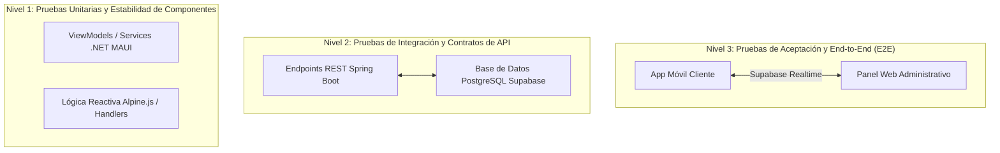

# PLAN INTEGRAL DE PRUEBAS DE SOFTWARE (SISTEMA SHUSHINE STUDIO)
## Norma Técnica de Referencia: ISO/IEC/IEEE 29119-3 / IEEE 829
**Proyecto:** Shushine Studio — Ecosistema Omnicanal (App Móvil + Panel Web + Backend API + Supabase DB)  
**Versión:** 2.0 (Estabilización y Despliegue en Tiempo Real)  
**Fecha de Emisión:** 12 de Octubre de 2026  
**Responsable QA / Scrum Master:** Alex Fernando Alfaro Diaz  

---

## 1. ALCANCE Y OBJETIVOS DEL PLAN DE PRUEBAS

El presente plan establece la estrategia, cobertura, criterios de aceptación y matrices de casos de prueba para garantizar la calidad total de los componentes desarrollados y estabilizados:

1. **Aplicación Móvil Cliente (.NET MAUI en Android):** Autenticación persistente, navegación reactiva sin bloqueos, visualización unívoca de citas, agenda y canal de chat atelier.
2. **Panel Administrativo Web (Alpine.js + Tailwind CSS):** Monitoreo en tiempo real, chat bidireccional de soporte, filtrado de agenda (Citas de Hoy / Historial / Filtro por Día), registro de citas locales/web, entrada de stock de inventario y KPIs dinámicos sin datos simulados.
3. **Capa de Integración y Base de Datos (Spring Boot API + Supabase PostgreSQL Realtime):** Sincronización en vivo entre plataformas, seguridad de token JWT y consistencia transaccional.

---

## 2. ESTRATEGIA DE PRUEBAS POR NIVELES (PIRÁMIDE DE PRUEBAS)

| Nivel de Prueba | Objetivo Técnico | Entorno / Herramienta | Enfoque |
| :--- | :--- | :--- | :--- |
| **Nivel 1: Unitarias** | Validar métodos individuales, lógica de persistencia y viewmodels sin dependencias vivas. | xUnit, Moq, JUnit 5 | Caja Blanca (White-Box) |
| **Nivel 2: Integración / API** | Validar comunicación HTTP, contratos JSON, autenticación JWT y persistencia en Supabase. | Postman / Newman / REST Client | Caja Gris (Gray-Box) |
| **Nivel 3: Sistema y Aceptación (UAT)** | Validar flujos de negocio completos del cliente y del administrador en dispositivos reales. | Dispositivo Android Físico, Chrome Browser | Caja Negra (Black-Box / BDD Gherkin) |

---

## 3. MATRIZ DE CASOS DE PRUEBA: APP MÓVIL CLIENTE (.NET MAUI)

### Módulo: Autenticación, Sesión y Navegación Shell

| ID Caso | Nombre del Caso | Precondición | Pasos de Ejecución | Resultado Esperado | Estado |
| :--- | :--- | :--- | :--- | :--- | :---: |
| **CP-MOB-01** | **Persistencia de Sesión al reiniciar la App** | Cliente autenticado exitosamente en el dispositivo. | 1. Iniciar sesión con credenciales válidas. 2. Salir al launcher de Android. 3. Cerrar la app desde el menú de aplicaciones recientes. 4. Reabrir la app desde el ícono. | La app abre **directamente en la pantalla de Inicio** (`ClientHomePage`). No solicita contraseña ni muestra la pantalla de Login. | ✅ **APROBADO** |
| **CP-MOB-02** | **Cierre de Sesión Voluntario y Cambio de Cuenta** | Sesión activa en el dispositivo. | 1. Ir a pestaña "Perfil". 2. Presionar botón "Cerrar sesión". 3. Confirmar diálogo de seguridad. 4. Ingresar credenciales de una segunda cuenta diferente. | La sesión anterior se purga completamente de `SecureStorage` y `Preferences`. Se inicia sesión con la nueva cuenta en tiempo real. | ✅ **APROBADO** |
| **CP-MOB-03** | **Navegación Shell sin Excepciones ni Crashes** | App abierta en pantalla de Inicio. | 1. Pulsar botón "Agendar una cita". 2. Pulsar botón "Servicios". 3. Pulsar botón "Solicitudes". 4. Pulsar botón "Chat". | Cada botón redirige a su pestaña o vista correspondiente sin salirse de la aplicación ni disparar `ArgumentException`. | ✅ **APROBADO** |
| **CP-MOB-04** | **Exclusión Mutua en Tarjeta 'Tu Próxima Cita'** | Cliente con 1 cita confirmada registrada en Supabase. | 1. Abrir pantalla de Inicio. 2. Observar la sección "Tu Próxima Cita". | Se visualiza **únicamente** la tarjeta con los datos de la cita activa (fecha, hora, servicio, estilista). La tarjeta "Sin citas pendientes" queda oculta. | ✅ **APROBADO** |
| **CP-MOB-05** | **Navegación al Detalle de Cita sin Cierre Forzoso** | Tarjeta de próxima cita visible en Inicio. | 1. Tocar sobre la tarjeta de la cita o en "Ver detalle ›". | La app transiciona limpiamente a `AppointmentDetailPage` mostrando el resumen de la reserva sin generar excepciones de casteo. | ✅ **APROBADO** |
| **CP-MOB-06** | **Pestaña Mis Citas (Próximas vs Historial)** | Cliente con citas registradas. | 1. Seleccionar pestaña "Citas". 2. Alternar entre selector "Próximas" e "Historial". 3. Probar pull-to-refresh deslizando hacia abajo. | Se renderizan las listas con sus insignias de estado correspondientes sin fallos visuales ni solapamiento de EmptyStates. | ✅ **APROBADO** |

---

## 4. MATRIZ DE CASOS DE PRUEBA: PANEL ADMINISTRATIVO WEB

### Módulo: Dashboard, Agenda, Chat y Control de Stock

| ID Caso | Nombre del Caso | Precondición | Pasos de Ejecución | Resultado Esperado | Estado |
| :--- | :--- | :--- | :--- | :--- | :---: |
| **CP-WEB-01** | **Módulo de Chat & Soporte en Tiempo Real** | Admin logueado en el panel; cliente envía mensaje desde móvil. | 1. Ir a sección "Chat & Soporte" en barra lateral. 2. Seleccionar la conversación del cliente. 3. Escribir respuesta en el campo de texto. 4. Hacer clic en "Enviar" (o Enter). | El mensaje se inserta en Supabase (`tabla mensajes`) con remitente del admin y se refleja inmediatamente en el hilo de chat. | ✅ **APROBADO** |
| **CP-WEB-02** | **Filtrado de Agenda: Citas de Hoy por Defecto** | Existen citas de diversas fechas en la base de datos. | 1. Ingresar al módulo "Agenda & Citas". 2. Verificar filtro activo predeterminado. | La tabla muestra por defecto **únicamente las citas de la fecha actual** con su banner de resumen. | ✅ **APROBADO** |
| **CP-WEB-03** | **Filtrado de Agenda: Ver Todo (Historial) y Filtro por Día** | Módulo de Agenda abierto. | 1. Pulsar botón "Ver Todo (Historial)". 2. Seleccionar una fecha específica en el datepicker de "Filtrar por Día". 3. Filtrar por estado (Confirmadas / Pendientes). | La tabla conmuta en vivo mostrando el historial completo o únicamente las del día seleccionado según los filtros. | ✅ **APROBADO** |
| **CP-WEB-04** | **Creación de Cita desde Modal del Panel Web** | Formulario de Nueva Cita abierto. | 1. Pulsar "+ Nueva Cita". 2. Seleccionar cliente, servicio, estilista, fecha y hora. 3. Confirmar guardado. | La cita se inserta en Supabase con código único `#SHU-2026-XXXX`, se actualiza la tabla y se notifica con Toast flotante. | ✅ **APROBADO** |
| **CP-WEB-05** | **Registro de Entrada de Stock en Inventario** | Módulo "Inventario del Salón" abierto. | 1. Pulsar "Entrada de Stock". 2. Seleccionar producto del catálogo. 3. Ingresar cantidad (+10 u.) y motivo. 4. Confirmar ingreso. | Se registra el movimiento en `movimientos_inventario`, se actualizan las existencias físicas y el badge cambia a "Óptimo". | ✅ **APROBADO** |
| **CP-WEB-06** | **KPIs y Alertas Reales (Sin Datos Simulados)** | Dashboard Ejecutivo abierto. | 1. Revisar las 4 tarjetas de KPIs superiores. 2. Hacer clic en la campana de notificaciones. | Métricas calculadas con datos reales de Supabase ($693.82 ventas, citas del día, clientes VIP). Alertas emitidas solo por stock bajo o citas pendientes reales. | ✅ **APROBADO** |

---

## 5. MATRIZ DE CASOS DE PRUEBA: INTEGRACIÓN END-TO-END (OMNICANAL)

| ID Caso | Escenario de Integración | Procedimiento | Criterio de Éxito |
| :--- | :--- | :--- | :--- |
| **CP-INT-01** | **Reflejo en Panel Web de Cita agendada desde App Móvil** | El cliente reserva "Corte & Brushing" en el celular. | En menos de 5 segundos, la cita aparece en la Agenda del Panel Web con etiqueta "App Móvil" y dispara alerta en tiempo real. |
| **CP-INT-02** | **Reflejo en App Móvil de Cita agendada desde Panel Web** | El recepcionista registra cita para el cliente en el Panel Web. | Al abrir la app el cliente, la sección "Tu Próxima Cita" y "Mis Citas" muestran la nueva reserva agendada. |
| **CP-INT-03** | **Mensajería Bidireccional Chat Móvil <-> Chat Admin Web** | Cliente envía: *"Hola, tengo una consulta"* desde la App Móvil. Admin responde: *"Con gusto le atendemos"* desde la Web. | Ambos mensajes se reciben recíprocamente en tiempo real sin requerir recargar la página ni reiniciar la app. |

---

## 6. CRITERIOS DE ACEPTACIÓN Y SIGN-OFF

* **Criterio de Aprobación de Salida (Exit Criteria):**
  - 100% de los casos de prueba críticos (CP-MOB-01 al CP-MOB-06 y CP-WEB-01 al CP-WEB-06) en estado **APROBADO (PASS)**.
  - Cero defectos bloqueantes de severidad 1 (sin cierres forzosos de app, sin pérdida de sesión al reiniciar).
  - Persistencia transaccional confirmada en Supabase PostgreSQL sin datos simulados.
